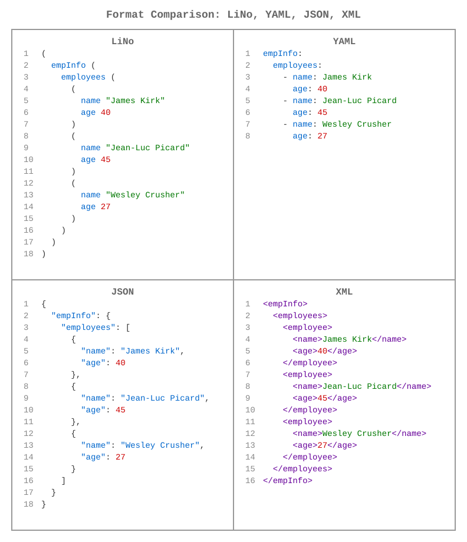

# [links-notation](https://github.com/link-foundation/links-notation) (languages: en • [ru](README.ru.md))

| [](https://github.com/link-foundation/links-notation/actions/workflows/js.yml) | [](https://www.npmjs.com/package/links-notation) | **[JavaScript](js/README.md)** |
|:-|-:|:-|
| [](https://github.com/link-foundation/links-notation/actions/workflows/js.yml) | [](https://crates.io/crates/links-notation) | **[Rust](rust/links-notation/README.md)** |
| [](https://github.com/link-foundation/links-notation/actions/workflows/js.yml) | [](https://www.nuget.org/packages?q=packageid%3Alinks-notation) | **[C#](csharp/README.md)** |
| [](https://github.com/link-foundation/links-notation/actions/workflows/js.yml) | [](https://pypi.org/project/links-notation/) | **[Python](python/README.md)** |
| [](https://github.com/link-foundation/links-notation/actions/workflows/js.yml) | [](https://pkg.go.dev/github.com/link-foundation/links-notation/go) | **[Go](go/README.md)** |
| [](https://github.com/link-foundation/links-notation/actions/workflows/js.yml) | [](https://central.sonatype.com/artifact/io.github.link-foundation/links-notation) | **[Java](java/README.md)** |
| [](https://github.com/link-foundation/links-notation/actions/workflows/js.yml) | [](https://packagist.org/packages/link-foundation/links-notation) | **[PHP](php/README.md)** |
| [](https://github.com/link-foundation/links-notation/actions/workflows/js.yml) | [](https://github.com/link-foundation/links-notation/releases?q=cpp_&expanded=true) | **[C++](cpp/README.md)** |
| [](https://github.com/link-foundation/links-notation/actions/workflows/js.yml) | [](swift/README.md#installation) | **[Swift](swift/README.md)** |
| [](https://github.com/link-foundation/links-notation/actions/workflows/js.yml) | [](https://central.sonatype.com/artifact/io.github.link-foundation.kotlin/links-notation) | **[Kotlin](kotlin/README.md)** |

[](https://gitpod.io/#https://github.com/link-foundation/links-notation)
[](https://github.com/codespaces/new?hide_repo_select=true&ref=main&repo=link-foundation/links-notation)

[](https://app.codacy.com/gh/link-foundation/links-notation?utm_source=github.com&utm_medium=referral&utm_content=link-foundation/links-notation&utm_campaign=Badge_Grade_Settings)
[](https://www.codefactor.io/repository/github/link-foundation/links-notation)

Link Foundation's Links Notation Class Library.

Development starts in JavaScript and is checked against all ten hand-written
bindings. See [contributing](CONTRIBUTING.md), the [parity contract](parity/README.md),
and [release setup](docs/releases.md). All language CI now uses the same entry workflow.



This library gives you an ability to convert any string that contains
links notation into a list of links and back to the string after
modifications are made.

Links notation is based on two concepts references and links. Each
reference references other link. The notation supports links with any
number of references to other links.

## Quick Start

### C&#35;

```csharp
var parser = new Link.Foundation.Links.Notation.Parser();
var links = parser.Parse("papa (lovesMama: loves mama)");
```

### JavaScript

```javascript
import { Parser } from "links-notation";
const parser = new Parser();
const links = parser.parse("papa (lovesMama: loves mama)");
```

### Rust

```rust
use links_notation::parse_lino;
let links = parse_lino("papa (lovesMama: loves mama)").unwrap();
```

### Python

```python
from links_notation import Parser
parser = Parser()
links = parser.parse("papa (lovesMama: loves mama)")
```

### Go

```go
import lino "github.com/link-foundation/links-notation/go"
links, _ := lino.Parse("papa (lovesMama: loves mama)")
```

### Java

```java
import io.github.linkfoundation.linksnotation.Parser;
Parser parser = new Parser();
List<Link> links = parser.parse("papa (lovesMama: loves mama)");
```

### PHP

```php
use LinkFoundation\LinksNotation\Parser;
$parser = new Parser();
$links = $parser->parse("papa (lovesMama: loves mama)");
```

### C++

```cpp
#include "links_notation.hpp"
std::vector<links_notation::Link> links = links_notation::parse("papa (lovesMama: loves mama)");
```

### Swift

```swift
import LinksNotation
let links = try Parser().parse("papa (lovesMama: loves mama)")
```

### Kotlin

```kotlin
import io.github.linkfoundation.linksnotation.Parser
val links = Parser().parse("papa (lovesMama: loves mama)")
```

## Examples

### Links notation (lino)

#### Doublets (2-tuple)

```lino
papa (lovesMama: loves mama)
son lovesMama
daughter lovesMama
all (love mama)
```

#### Triplets (3-tuple)

```lino
papa has car
mama has house
(papa and mama) are happy
```

#### Sequences (N-tuple)

```lino
I'm a friendly AI.
(I'm a friendly AI too.)
(linksNotation: links notation)
(This is a linksNotation as well)
(linksNotation supports (unlimited number (of references) in each link))
(sequence (of references) surrounded by parentheses is a link)
parentheses may be ommitted if the whole line is a single link
```

#### Indented Syntax

Links can also use indented syntax for better readability:

```lino
3:
  papa
  loves
  mama
```

This is equivalent to:

```lino
(3: papa loves mama)
```

For indented IDs, `Parser.parse('x:\n  a\n  b')` reads `(x: a b)`.
`parse` defines the canonical link values. In JavaScript, C++, Swift and Kotlin,
`parseGroups` exposes the indentation separately: the `x:` element is a self
reference with an empty value list, and its children are references `a` and `b`.
Folding those children into the element's values gives the same link as `parse`.
Explicit `(a)` remains a one-value link. Under an ordinary head such as
`x: kind`, child lines remain links and `parse` expands indentation into paths.
See the [JavaScript folding example](js/README.md#indented-id-groups).

#### Multi-line Groups

A parenthesized group opens a *nested context*: its body starts fresh at
indentation level zero and follows the same rules the root document does, so a
line break inside parentheses is structure rather than decoration.

```lino
value (
  id "1"
  label "one"
)
```

This reads as `(value ((id 1) (label one)))` - two children, each a link of its
own - and not as one flat list in which the boundary between `id` and `label`
would be lost. Indentation works inside a group exactly as it does at the root,
and a body that stays on a single line still collapses to a single link, so
`(a b c)` is unchanged.

All ten implementations agree on this: each native test suite reads the
document above as the shared `context` case of
[`parity/text-fixtures.json`](parity/text-fixtures.json), and
`experiments/issue-282/parity` parses it with the eight earlier ones side by
side and fails if any one reads it differently.
The complete rules are in the [grammar](docs/grammar/GRAMMAR.md).

#### Comments

A `#` hides the rest of the line it stands on, so a document can carry prose
about itself:

```lino
# the machines this deploys to
deploy: staging # only staging, for now
```

That is the single link `(deploy: staging)`: both comments are gone by the time
the document is read. A `#` only opens a comment where a reference could begin,
so a `#` inside a token (`issue#1047`) and a `#` inside a delimited reference
(`"#"`) stay ordinary characters.

A formatter keeps the same rule from the other side: a reference that begins
with a `#` is written quoted (`'#tag'`), so a document it writes reads back as
itself.

Comments are on by default in every implementation, and every parser can be
told to read `#` as an ordinary character again for documents written before
comments existed - see the parser options in the language READMEs.

So that means that *this* text is also links notation. So most of the
text in the world already may be parsed as links notation. That makes
links notation the most easy an natural/intuitive/native one.

## What is Links Notation?

Links Notation (Lino) is a simple, intuitive format for representing
structured data as links between ~~entities~~ references to links.
It's designed to be:

- **Natural**: Most text can already be parsed as links notation
- **Flexible**: Supports any number of references in each link
- **Universal**: Can represent doublets, triplets, and N-tuples
- **Hierarchical**: Supports nested structures with indentation

The notation uses two core concepts:

- **References**: Points to other links (like variables or identifiers)
- **Links**: Connect references together with optional identifiers

## Streaming

Every maintained implementation can parse arbitrary chunks incrementally,
including one-symbol and one-line chunks. A stream emits a top-level record only
after its indented children, multiline quoted references, and parenthesized
contexts are complete. The canonical parser validates each completed record, so
streaming and whole-document parsing have the same syntax and output.

| Language | Push API | Lazy/native adapter |
| --- | --- | --- |
| C# | `LinkParsed` event | `IEnumerable` / `IAsyncEnumerable` |
| JavaScript | `link`, `error`, and `end` events | sync / async iterables |
| Rust | link and error callbacks | `Iterator` |
| Python | link callback | generator / async generator |
| Go | callback and `io.Writer` | `iter.Seq2` |
| Java | `Consumer<Link>` | `Stream<Link>` |
| PHP | callable | `Generator` |
| C++ | `on_link` / `on_error` callbacks | `ChunkedLinks` / `parse_chunks` |
| Swift | `onLink` / `onError` handlers | `Sequence` / `AsyncSequence` |
| Kotlin | `onLink`, `onError` and `onEnd` listeners | `Sequence` via `StreamParser.parse` |

All variants expose write/feed and finish operations, absolute position
tracking, reset/drain controls, and an unresolved-record size limit. Collection
is enabled by default; disable it when callbacks or lazy iteration should keep
memory bounded. See the [cross-language parity experiment](experiments/issue-197/README.md)
and each language README for runnable examples.

## How a document was written

`1` and `'1'` are the same reference, so equality and formatting treat
`(t 1 '1')` and `(t 1 1)` alike. The parser still records how each ID was
written: every parsed link with an ID carries its raw text (`'1'`) and its
quote (`'`). This metadata is on by default; an AST mode leaves it out. For the
whole text, every implementation also returns a lossless concrete syntax tree
(CST): each character, comments, whitespace, blank lines and line endings
included, belongs to exactly one token, so the tree's text is the document.

| Language | Raw text and quote | AST mode | CST |
| --- | --- | --- | --- |
| C# | `RawId`, `Quote` | `new Parser { Syntax = false }` | `ParseCst` |
| JavaScript | `rawId`, `quote` | `new Parser({ syntax: false })` | `parseCst` |
| Rust | `parse_lino_to_syntax_links` → `raw_id()`, `quote()` | `parse_lino` | `parse_lino_to_cst` |
| Python | `raw_id`, `quote` | `Parser(syntax=False)` | `parse_cst` |
| Go | `RawID`, `Quote()` | `Parser.Syntax = false` | `ParseCst` |
| Java | `getRawId()`, `getQuote()` | `new Parser(comments, false)` | `parseCst` |
| PHP | `getRawId()`, `getQuote()` | `new Parser(syntax: false)` | `parseCst` |
| C++ | `raw_id`, `quote()` | `ParserOptions::syntax = false` | `parse_cst` |
| Swift | `rawId`, `quote` | `ParserOptions(syntax: false)` | `parseCst` |
| Kotlin | `rawId`, `quote` | `Parser(ParserOptions(syntax = false))` | `parseCst` |

Every implementation checks the shared golden data in
[`parity/syntax-fixtures.json`](parity/syntax-fixtures.json) and restores every
shared fixture exactly from its CST. See the
[issue 364 case study](docs/case-studies/issue-364/README.md).

## Documentation

For detailed implementation guides and API references, see the
language-specific documentation:

- **[C# Documentation](https://link-foundation.github.io/links-notation/csharp/api/Link.Foundation.Links.Notation.html)**
  \- Complete API reference
- **[PDF Documentation](https://link-foundation.github.io/links-notation/csharp/Link.Foundation.Links.Notation.pdf)**
  \- Complete reference for offline reading
- **[C# README](csharp/README.md)** - Installation and usage guide
- **[JavaScript README](js/README.md)** - Modern web development guide
- **[Rust README](rust/links-notation/README.md)** - High-performance parsing guide
- **[Python README](python/README.md)** - Python package guide
- **[Go README](go/README.md)** - Go package guide
- **[Java README](java/README.md)** - Java/Maven package guide
- **[PHP README](php/README.md)** - PHP/Composer package guide
- **[C++ README](cpp/README.md)** - C++17/CMake library guide
- **[Swift README](swift/README.md)** - Swift package guide
- **[Kotlin README](kotlin/README.md)** - Kotlin Multiplatform/Gradle library guide

Additional resources:

- [Grammar](docs/grammar/GRAMMAR.md) - The notation in EBNF, with the indentation
  and nested context rules spelled out ([syntax diagrams](docs/grammar/syntax-diagrams.md))
- [Test Case Comparison](TEST_CASE_COMPARISON.md) - Test-by-test coverage comparison across all ten language implementations
- [Links Theory 0.0.2](https://habr.com/en/articles/895896/) - Theoretical
  foundation that Links Notation fully supports

## Test Coverage & Implementation Parity

All ten language implementations (C#, JavaScript, Rust, Python, Go, Java, PHP, C++, Swift, Kotlin) maintain
**equivalent core functionality**, and the overlap is verified test by test rather than asserted:

<!-- test-counts:start -->
| Language | Tests | Test categories |
| --- | --- | --- |
| Python | 279 | 27 |
| JavaScript | 351 | 34 |
| Rust | 430 | 32 |
| C# | 325 | 30 |
| Go | 167 | 20 |
| Java | 214 | 19 |
| PHP | 265 | 26 |
| C++ | 380 | 32 |
| Swift | 349 | 35 |
| Kotlin | 358 | 33 |
<!-- test-counts:end -->

The table is written by `scripts/create-test-case-comparison.mjs`, which reads the test files
themselves and also produces [TEST_CASE_COMPARISON.md](TEST_CASE_COMPARISON.md) - the full matrix
of which implementation has which test, each cell linking to the test. The `docs` workflow runs
that script with `--check` on every pull request, so a test added in one language and forgotten in
the others shows up as a gap in the matrix instead of as a README that quietly went stale. It used
to be a hand-written list, and had drifted to six languages and six wrong counts.

### Known Implementation Differences

Some language-specific features are intentional:

- **`LinksGroup`** - a parsed group of links kept as one object - exists in
  [JavaScript](js/src/LinksGroup.js), [C#](csharp/Link.Foundation.Links.Notation/LinksGroup.cs),
  [Java](java/src/main/java/io/github/linkfoundation/linksnotation/LinksGroup.java),
  [C++](cpp/include/links_notation/links_group.hpp),
  [Swift](swift/Sources/LinksNotation/LinksGroup.swift) and
  [Kotlin](kotlin/src/commonMain/kotlin/io/github/linkfoundation/linksnotation/LinksGroup.kt).
  Python, Rust, Go and PHP expose the same structure as nested `Link` values
  instead.
- **Tuple conversion** - building a link from a language tuple - is offered where the language has
  the syntax for it: [C#](csharp/Link.Foundation.Links.Notation/Link.cs) via implicit operators and
  [Rust](rust/links-notation/src/lib.rs) via `From` implementations.

These differences are by design and do not affect core parsing/formatting functionality.

## Binary links notation

The [version 1 specification](docs/protocol/binary-links-notation.md) defines
shared packets and a LiNo document mapping. JavaScript, Python, Rust, C#, Go,
Java, PHP, C++, Swift and Kotlin provide codecs beside their text parsers; all
check the same [golden vectors](docs/protocol/binary-links-notation-vectors.txt).
See the [cross-language example](examples/binary/README.md) for encoding options
and byte-for-byte interoperability.

Exact Unicode identifiers and values round-trip with the [reference literal contract](docs/protocol/reference-literals.md)
introduced in 0.24.0, including mixed quotes, empty strings, controls and multiline text.
